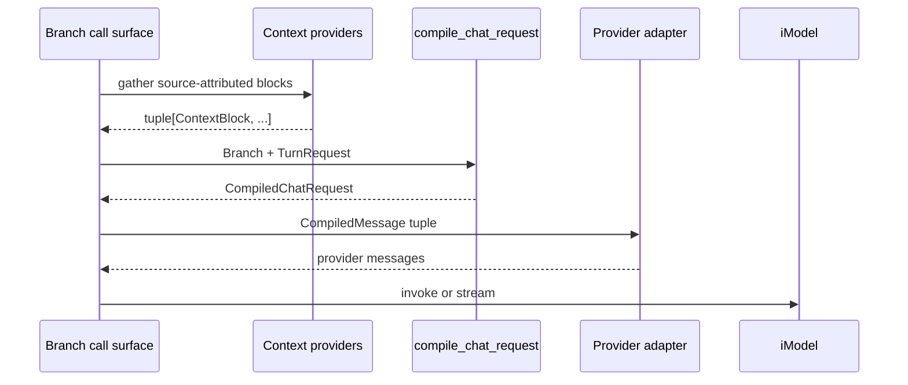

# ADR-0007: Canonical turn-request compilation boundary

- **Status**: Proposed, amended 2026-10-16 (see Amendment 1)
- **Kind**: Aspirational
- **Implementation-status**: not-started
- **Area**: messages-context
- **Date**: 2026-07-09
- **Relations**: extends ADR-0006

## Context

LionAGI currently distributes provider-request preparation across durable message content, a raw
projection, an unused general preparation helper, and the active chat/run preparation path. The
result works for ordinary turns but does not give one place an exact request contract.

**P1 — `Instruction` currently mixes durable and one-call lifetimes.** `InstructionContent`
contains stable user material (`instruction`, `guidance`, `prompt_context`, `plain_content`, and
images) alongside current-call tool schemas, response-format objects, structure objects, and a
rendering instance (`lionagi/protocols/messages/instruction.py`). Serialization conditionally strips
the objects that cannot round-trip, and in-memory copies carry special cases to keep them alive.
Replay therefore depends on remembering which fields are transient rather than making that
lifetime explicit.

**P2 — Three surfaces project history with different semantics.**

- `MessageManager.to_chat_msgs()` is a raw ordered `chat_msg` projection. It does no prompt
  shaping (`lionagi/protocols/messages/manager.py`).
- `prepare_messages_for_chat()` extracts a leading system record, folds action results, clears
  historical schemas, merges assistant messages, and can render round notifications. It has no
  production caller (`lionagi/protocols/messages/prepare.py`).
- `_prepare_run_kwargs()` is the active chat and run path. It performs a different action fold,
  assistant merge, system fold, context-provider injection, filtering, and final rendering
  (`lionagi/operations/chat/_prepare.py`).

Two helpers can therefore assign different provider-visible meanings to the same record sequence.

**P3 — History selection and malformed-history behavior are implicit.** The active path chooses
`param.progression or branch.progression`, looks up every UUID, ignores some message kinds, and
requires the first retained item to be an instruction only when a system message exists. Invalid
IDs surface through collection lookup; adjacent non-assistant retained records can be silently
dropped by the current merge loop. Those are control-flow accidents, not a named contract.

**P4 — Ephemeral context needs attribution and syntax boundaries.** ADR-0008 records that current
provider blocks are joined and concatenated directly between system text and guidance. The request
compiler needs a typed block input and an exact encoding so source attribution survives to the
provider request and retrieved text cannot become adjacent to policy merely because delimiters
were omitted. This is a data-boundary improvement, not a claim that retrieved text becomes trusted.

**P5 — Chat and run must agree before transport-specific execution begins.** Both paths already
call `_prepare_run_kwargs()`, but they then mutate call arguments differently: chat invokes an API
event, while run adds streaming, resume, deadline, and persistence behavior. Compilation belongs
before that fork so transport mechanics cannot redefine history.

**P6 — Migration must preserve normal provider payloads while removing duplicate authority.** The
existing `Branch.chat`, `communicate`, `operate`, and `run` signatures cannot all change at once.
They need an adapter into one typed request, characterization tests for current successful
histories, and one removal/delegation plan for legacy helpers.

| Concern | Decision |
|---------|----------|
| Durable versus transient turn data | D1: Introduce immutable `TurnRequest`, `ContextBlock`, `CompiledMessage`, and `CompiledChatRequest` contracts. |
| History selection and folding | D2: Make `compile_chat_request()` the sole owner of validation, action folding, assistant normalization, system placement, and rendering. |
| Context attribution and boundaries | D3: Encode context blocks as canonical JSON in a separately delimited guidance section. |
| Service boundary | D4: Keep compiled messages provider-neutral; adapters translate them only at model invocation. |
| Chat/run parity | D5: Require chat and run to consume the same compiled result before adding transport-only keyword arguments. |
| Migration and old helpers | D6: Adapt existing Branch arguments into `TurnRequest`, characterize payloads, then delegate or remove every competing preparation path. |
| Bound visibility | D7: Give every compiled section a declared bound and posture, and record both the kept and the left-out material on the compiled request. |
| Section authority | D8: Type every compiled section with an authority level and refuse a material block presented as operator or run-instruction authority. |

This ADR deliberately does **not** decide:

- how context providers retrieve or prioritize blocks; ADR-0008 owns provider execution and
  supplies `ContextBlock` values to this boundary;
- tool execution, action concurrency, or action-result writeback; compilation only represents
  recorded results in model context;
- response parsing or Pydantic validation after the model call;
- provider transport, retry, rate-limit, streaming, or persistence behavior;
- a new public `Branch.chat` or `Branch.run` signature. Existing call surfaces adapt into the new
  contract first; or
- a new system-role wire message. The target keeps the shipped system-into-first-user-message fold
  so this refactor does not also change the role sequence.

## Decision

### D1 — Separate record-ready instruction data from transient call data

The operation layer introduces the following exact Python-native contract in
`lionagi/operations/types.py`:

```python
from collections.abc import Mapping
from dataclasses import dataclass, field
from types import MappingProxyType
from typing import Any
from uuid import UUID

from pydantic import BaseModel

from lionagi.operations.schema.structure import Structure
from lionagi.protocols.messages import Instruction, MessageRole


@dataclass(frozen=True, slots=True)
class ContextBlock:
    provider_name: str
    content: str
    authority: SectionAuthority = field(  # Amended by D8
        default=SectionAuthority.MATERIAL, init=False
    )

    @classmethod
    def from_provider(cls, provider_name: str, content: str) -> "ContextBlock":
        """A registry's block: authority is MATERIAL by construction."""
        return cls._of(SectionAuthority.MATERIAL, provider_name, content)

    @classmethod
    def from_operator(cls, provider_name: str, content: str) -> "ContextBlock":
        """Operator text: authority is OPERATOR by construction."""
        return cls._of(SectionAuthority.OPERATOR, provider_name, content)

    @classmethod
    def from_run_instruction(cls, provider_name: str, content: str) -> "ContextBlock":
        """The caller's instruction: authority is RUN_INSTRUCTION by construction."""
        return cls._of(SectionAuthority.RUN_INSTRUCTION, provider_name, content)

    @classmethod
    def _of(
        cls, authority: SectionAuthority, provider_name: str, content: str
    ) -> "ContextBlock":
        block = cls(provider_name=provider_name, content=content)
        object.__setattr__(block, "authority", authority)
        return block


@dataclass(frozen=True, slots=True)
class CompiledMessage:
    role: MessageRole
    content: str | list[dict[str, Any]]


@dataclass(frozen=True, slots=True)
class TurnRequest:
    instruction: Instruction
    progression: tuple[UUID, ...] | None = None
    tool_schemas: tuple[dict[str, Any], ...] = ()
    response_format: type[BaseModel] | dict[str, Any] | BaseModel | None = None
    structure: type[Structure] | str | None = None
    context_blocks: tuple[ContextBlock, ...] = ()
    skipped: tuple[LeftOut, ...] = ()  # Amended by D7
    provider_kwargs: Mapping[str, Any] = field(
        default_factory=lambda: MappingProxyType({})
    )


@dataclass(frozen=True, slots=True)
class CompiledChatRequest:
    instruction: Instruction
    messages: tuple[CompiledMessage, ...]
    provider_kwargs: Mapping[str, Any]
    bounds: tuple[SectionBound, ...]  # Amended by D7; required, no default


def compile_chat_request(
    branch: Branch,
    request: TurnRequest,
) -> CompiledChatRequest: ...
```

The per-instance mapping factory avoids sharing mutable call state and exposes a read-only empty
default.

Amended by D7: `CompiledChatRequest` also carries `bounds`, the tuple of `SectionBound` records,
and that field is required, with no default; `TurnRequest` also carries `skipped`, the tuple of
`LeftOut` records naming the entries the context registry did not admit, each with its reason.
Amended by D8: `ContextBlock` also carries `authority`, a `SectionAuthority` set from the origin
that built the block rather than passed by the caller. The additions are defined in Amendment 1
below.

After migration, the durable instruction content contract is reduced to provider-neutral fields:

```python
# lionagi/protocols/messages/instruction.py
@dataclass(slots=True)
class InstructionContent(MessageContent):
    instruction: str | None = None
    guidance: str | None = None
    prompt_context: list[Any] = field(default_factory=list)
    plain_content: str | None = None
    images: list[str] = field(default_factory=list)
    image_detail: Literal["low", "high", "auto"] | None = None
```

`tool_schemas`, `response_format`, `structure`, and `_structure_instance` no longer remain fields on
the target durable dataclass. During the compatibility window, `InstructionContent.from_dict()`
accepts those keys from legacy serialized content and ignores them; replay cannot reconstruct a
current-call option. The Branch call adapters continue accepting their existing arguments and place
them on `TurnRequest`.

The lifetime split is normative:

| Data | Durable `CompiledChatRequest.instruction` | Transient `TurnRequest` / compiled messages |
|------|---------------------------------------------|---------------------------------------------|
| instruction text | yes | rendered from durable copy |
| stable guidance and prompt context | yes | rendered from durable copy |
| plain content and images | yes | rendered from durable copy |
| sender, recipient, identity, metadata | yes | used only as needed for compilation |
| tool schemas | no | `TurnRequest.tool_schemas` |
| response format and structure | no | `TurnRequest.response_format` / `structure` |
| selected progression | no | `TurnRequest.progression` |
| context-provider blocks | no | `TurnRequest.context_blocks` |
| skipped context entries | no | `TurnRequest.skipped` |
| model-call keyword arguments | no | `TurnRequest.provider_kwargs` |

Exact construction semantics:

- `TurnRequest.instruction` is an `Instruction`, not raw text. Existing Branch entry points first
  build it through the current instruction factory so sender/recipient, context, images, and
  content validation retain their public behavior.
- The compiler makes a deep model copy of the supplied instruction, preserving its `id`,
  `created_at`, sender, recipient, and metadata values. It replaces that copy's content with the
  target `InstructionContent` built from only instruction, guidance, prompt context, plain content,
  images, and image detail. The supplied `Instruction` is never mutated.
- The compiler builds a private ephemeral rendering view for the current call. That view combines
  durable content with `tool_schemas`, `response_format`, and `structure` from `TurnRequest` and
  preserves the current minimal-YAML Tools, ResponseSchema, and ResponseFormat sections.
- Historical instruction copies use only the target durable fields, so an old in-memory record
  created before migration cannot replay a schema into a later call.
- `CompiledChatRequest.instruction` is the only instruction object that chat/communicate/run may
  record after compilation. It contains no context blocks or current-call model kwargs.
- The frozen dataclasses prevent field reassignment but do not make nested dictionaries or
  multimodal lists immutable. The compiler uses `copy.deepcopy()` for schema dictionaries,
  provider kwargs, and rendered list content, then exposes compiled kwargs through
  `MappingProxyType`. Caller-owned mutable containers are not retained by the compiled request.
- `provider_kwargs` may not contain the reserved key `"messages"`. A collision raises
  `ValueError("provider_kwargs must not contain reserved key 'messages'")` rather than silently
  overwriting either value.

This decision removes the need for serialization to be the mechanism that distinguishes durable
from transient state. Serialization remains a compatibility safeguard, not the lifetime boundary.

### D2 — One deterministic compiler owns selection, folding, and rendering

`compile_chat_request()` is a pure compilation step with respect to branch history: it reads the
branch and returns new values without mutating any stored message, progression, or content object.
Its algorithm is normative.

#### 1. Resolve and validate the history view

- `request.progression is None` selects `branch.progression`, including any
  `metadata["current_progression"]` override described by ADR-0006.
- An explicit empty tuple selects no historical messages.
- Existing public adapters preserve the current falsy-list behavior during migration by mapping a
  legacy `progression=[]` argument to `None`. Direct internal `TurnRequest(progression=())` is the
  unambiguous empty-history form.
- Every UUID must exist in `branch.msgs.messages`. Missing IDs are collected and reported in one
  `ValueError` before any compilation output is produced.
- Duplicate UUIDs are rejected with `ValueError`; replaying the same record twice is not an
  implicit feature.
- Order is exactly tuple/progression order, not creation time.

#### 2. Project provider-relevant history

The compiler walks the selected records once:

- `System` records are not emitted from the selected progression; the canonical
  `branch.msgs.system` is handled in the system fold below.
- `ActionRequest` records are not emitted independently. Their function and arguments are already
  present on the correlated `ActionResponse` content.
- `ActionResponse` records are accumulated until the next historical `Instruction`.
- `AssistantResponse` becomes an ephemeral copy of `AssistantResponseContent`.
- `Instruction` becomes an ephemeral copy with `tool_schemas=()`, `response_format=None`, and no
  structure instance. Pending action responses are carried into the request's `tool_results`
  section, never into its prompt context.
- A base `Message` or other record whose role is `unset` is ignored; routed traffic is not a
  provider conversation turn.
- Any future fixed-role conversational subtype not covered above raises `TypeError` so adding a
  subtype cannot silently change prompt semantics.

Action responses use the current provider-visible projection:

```python
{
    "function": response.content.function,
    "arguments": response.content.arguments,
    "output": response.content.output,
}
```

For each target instruction, projected dictionaries append to the request's `tool_results`
section in action-response order. A dictionary already equal to an existing prompt-context item
is not appended again. Pending responses after the last historical instruction belong to the
current turn's tool-results entry.

#### 3. Validate conversation ordering and merge assistant runs

- Consecutive `AssistantResponseContent` objects merge into one assistant message by joining their
  text with exactly `"\n\n"`.
- Adjacent retained instructions are rejected with `ValueError("Consecutive instructions require
  an intervening assistant response")`. The compiler does not preserve the current accidental
  silent drop.
- If a system message exists and retained history is non-empty, the first retained content must be
  an instruction. Otherwise compilation raises
  `ValueError("First message in progression must be an Instruction or System")`, preserving the
  active path's explicit error.
- With no retained history, the current ephemeral instruction is the first content.
- The current instruction is appended exactly once after retained history.

#### 4. Fold system, context, and guidance

The compiler keeps the shipped role sequence: it does not emit a provider `system` message. It
builds one guidance prefix and applies it to the first instruction content:

```text
<system.rendered, when present>

<context section from D3, when blocks are present>

<that instruction's existing guidance, when present>
```

Each non-empty section is joined with exactly two newline characters. Non-string guidance renders
through the existing minimal-YAML renderer before joining.

When retained history exists, the fold applies to its first instruction, matching current system
placement. Otherwise it applies to the current instruction. Context blocks can compile without a
system message; whether the provider registry runs on a systemless branch remains a migration
decision in ADR-0008.

#### 5. Render immutable provider-neutral messages

- Each instruction uses the existing structured instruction renderer and has role `user`.
  Historical views render only durable sections; the current ephemeral view additionally renders
  the TurnRequest's Tools, ResponseSchema, and ResponseFormat sections.
- Each assistant response renders its normalized text and has role `assistant`.
- Folded action results render in the request's `tool_results` section, one section per request,
  outside the instruction content, so D7's bound applies to them independently of the instruction.
- A falsy rendered value is omitted, matching the active path.
- Multimodal instruction content remains a list containing a text part and `image_url` parts.
- The returned `messages` tuple preserves the final content order.
- `CompiledMessage` contains only `role` and rendered `content`; message UUIDs and metadata do not
  enter the provider request.

#### 6. Apply section bounds and record both states (Amended by D7)

After the sections are assembled and rendered, the compiler applies each section's declared bound
and returns one `SectionBound` per section — system, history, context, tool_results — in
`CompiledChatRequest.bounds`. A section within its bound keeps everything, and its record carries
an empty `left_out`. A truncating section renders D7's marker inside itself and carries one
`left_out` entry per dropped item. A refusing section raises `SectionBudgetRefused` before the
provider call, and its records travel on that error. The step measures rendered text and never
mutates history.

The algorithm has no retry, timeout, token cap, or provider call. It is deterministic for the
branch snapshot and `TurnRequest` supplied. Callers that require a stable snapshot must avoid
concurrent history mutation while compiling; cross-task branch locking is outside this ADR.

### D3 — Context blocks use a canonical source-attributed JSON section

`ContextBlock` is data, not preformatted policy text. The compiler renders all blocks as one
canonical JSON array:

```python
from lionagi.ln import json_dumps

payload = [
    {
        "provider_name": block.provider_name,
        "content": block.content,
        "authority": block.authority.value,  # Amended by D8
    }
    for block in request.context_blocks
]
encoded = json_dumps(payload, sort_keys=True)
section = "LIONAGI_CONTEXT_BLOCKS_JSON\n" + encoded + "\nEND_LIONAGI_CONTEXT_BLOCKS_JSON"
```

The exact provider-visible shape for two blocks is:

```text
LIONAGI_CONTEXT_BLOCKS_JSON
[{"authority":"material","content":"first retrieved value","provider_name":"catalog"},{"authority":"material","content":"second retrieved value","provider_name":"memory"}]
END_LIONAGI_CONTEXT_BLOCKS_JSON
```

Amended by D8: each canonical JSON entry gains an `authority` key carrying the block's
`SectionAuthority` value. The array, `sort_keys`, escaping and the envelope delimiters are
unchanged, so the only difference from the shape above is that key.

Exact semantics:

- block order is `TurnRequest.context_blocks` order, which ADR-0008 defines as retained
  registration order;
- empty `provider_name` or `content` is rejected with `ValueError`; the registry should omit empty
  results before constructing blocks;
- JSON escaping preserves quotes, newlines, and control characters inside the `content` field;
- system text, the context section, and guidance are separate two-newline-delimited sections;
- context content remains untrusted model input. Attribution and syntactic encoding prevent
  accidental string adjacency; they do not authorize instructions found in retrieved data or
  guarantee resistance to semantic prompt injection; and
- the context section exists only in compiled content. Neither the JSON text nor the source blocks
  are copied into the record-ready instruction.

This target is the concrete source-attributed envelope required by ADR-0008 delta 1.

### D4 — Provider translation occurs after neutral compilation

The operation compiler returns `CompiledMessage`, not OpenAI-, Anthropic-, or CLI-specific request
objects. The default service projection is mechanically:

```python
provider_messages = [
    {"role": message.role.value, "content": message.content}
    for message in compiled.messages
]
```

Provider adapters may translate multimodal part names or other service-specific shapes at the
`iModel` boundary. They may not re-read `Branch.messages`, refold actions, move system policy,
re-run context providers, or mutate the compiled instruction. If a provider needs a native tools
field or response-format field, that translation is driven from explicit operation parameters,
not reconstructed from durable history.

An adapter error occurs before model invocation and leaves history unchanged. Recording happens
only after compilation succeeds and follows each operation's existing behavior: direct `chat()`
does not automatically record, `communicate()` records its instruction/response, and `run()`
records streamed messages.

### D5 — Chat and run share compilation and diverge only for execution

Both operation paths use the same sequence:



After compilation:

- chat selects the model from its existing `ChatParam`/Branch operation state, adds the deprecated
  `include_token_usage_to_model` value only when explicitly present, and invokes once;
- run verifies a CLI model, adds resume state, `stream=True`, an optional stream deadline, and
  optional persistence callbacks; and
- neither path changes `compiled.messages` or compiles a second time.

There is no separate `compile_run_request()`. Run-only settings such as `stream_persist`,
`persist_dir`, and `snapshot_dir` remain execution parameters and never enter `TurnRequest`.

### D6 — Migrate by adaptation, characterization, and removal of competing policy

The target module ownership is:

```text
lionagi/operations/
├── types.py                 TurnRequest, ContextBlock, CompiledMessage,
│                            CompiledChatRequest
└── chat/
    ├── _compile.py          compile_chat_request and pure helpers
    ├── _prepare.py          temporary compatibility adapter; then removed/delegated
    └── chat.py              provider invocation only

lionagi/protocols/messages/
├── manager.py              ordered raw records and factories only
└── prepare.py              compatibility delegation, then deprecation/removal
```

Migration order is part of the decision:

1. Capture current successful provider-visible payloads for chat and run: empty history, systemful
   and systemless history, action results, consecutive assistant responses, images, tools,
   response formats, selected progressions, and context-provider blocks.
2. Add the typed contracts and compiler without changing public Branch signatures.
3. Adapt `ChatParam`/`RunParam` plus the newly built instruction into `TurnRequest`. Preserve the
   legacy empty-progression behavior in that adapter.
4. Route both chat and run through the compiler. Any intentional difference—canonical context
   delimiters and explicit malformed-history errors in this ADR—gets a focused expectation rather
   than an accidental snapshot update.
5. Make `MessageManager.to_chat_msgs()` explicitly raw and keep it only for callers that want a
   literal record projection.
6. Delegate `prepare_messages_for_chat()` to the compiler where compatible, deprecate unsupported
   option combinations, then remove independent prompt policy at the declared compatibility
   boundary.
7. Remove `_prepare_run_kwargs()` after all production callers use the compiler.

Completion requires one payload test matrix shared by chat and run. A change that updates only one
side fails the boundary contract.

## Amendment 1 (2026-10-16) — both states of every bound, and a section authority

D1 through D6 decide what a compiled turn request is and who owns it. Two questions about the
material entering that request are left open, and this amendment decides both. When a bound
drops or truncates material, the compiled prompt carries only what survived: a reader of the
request cannot tell that something was left out, or what. And the sections that meet in the
guidance fold — system text, retrieved context blocks, caller guidance, folded action results —
arrive as untyped strings, so "what could have instructed the model in this call" is answered by
reading one long prompt rather than by querying a typed artifact.

The recap table in Context gained two rows for D7 and D8 below. D1's `CompiledChatRequest` and
`TurnRequest` and `ContextBlock` contracts, D2's algorithm and D3's example are amended in place
by D7 and D8, each marked `Amended by` at the field, step or key it changes. D4, D5 and D6 are
unchanged, as are the alternatives already recorded in this ADR.

### Context — what the code does today

The compiler this amendment extends does not exist yet, so the gap between it and the shipped
code is the starting state rather than a delta row. The current behavior, read at the cited
lines:

- the compiler does not exist. `lionagi/operations/types.py` holds the operation parameter
  dataclasses (`ChatParam` at `:102`, `RunParam` at `:141`) and the parse-error types
  (`ParseError` at `:32`), the `UnparsedResponse` string, and the `Middle` protocol at `:182`;
  `TurnRequest`, `ContextBlock`, `CompiledMessage`, `CompiledChatRequest`, `compile_chat_request`
  and any authority type are absent from it; `_prepare_run_kwargs()` is still the active chat/run
  path
  (`lionagi/operations/chat/_prepare.py:174`, called from `lionagi/operations/chat/chat.py:62`
  and `lionagi/operations/run/run.py:429`), and `prepare_messages_for_chat()` still stands
  separately (`lionagi/protocols/messages/prepare.py:100`);
- kept versus dropped: over a per-provider cap or over the total budget, the registry appends
  the provider name to `ProviderReport.skipped` and moves on
  (`lionagi/protocols/context_providers.py:115-117` and `:129-132`). Only the surviving texts
  are threaded into compilation, as `context_blocks: Sequence[str]`
  (`lionagi/operations/chat/_prepare.py:180`), and joined into the guidance fold with no marker
  (`:285-286`). The prompt therefore shows the kept state alone and never says material was
  dropped;
- outside the call, aggregate counters exist (`lionagi/protocols/context_providers.py:63-70`)
  and render per session (`lionagi/cli/monitor.py:669-680`), and `branch.last_context_report`
  exposes one turn's names (`lionagi/session/branch.py:291-303`). Those are event counts: they
  do not say what that same call kept, and one `skipped` list merges two causes with no reason
  code;
- an eviction path exists outside the compiler: the context tool's `evict` and
  `evict_action_results` actions remove messages from the active view
  (`lionagi/tools/context/context.py:290-304`, `:306-323`) by excluding them from
  `metadata["current_progression"]` (`:144-149`), which `Branch.progression` returns in place of
  the manager's progression when it is present (`lionagi/session/branch.py:248-254`). An evicted
  message vanishes from the compiled prompt with no marker and no left-out entry, so
  "an empty `left_out` means nothing was left out" is false today for any evicted message;
- a compaction path exists there too: the context tool's `compact` action replaces a span of
  messages with one assistant summary carrying `[CONTEXT COMPACTION]` and excludes the originals
  from the active view (`lionagi/tools/context/context.py:353-430`, the summary at `:417-423`).
  The summary is what the compiler sees, and it does not say which records it stands for;
- in-context omission markers do exist, one layer down, in the Codex provider, in three shapes: a
  head-and-tail cut of a bounded tool result's text, counting characters
  (`lionagi/providers/openai/codex.py:995-998`); a list's tail replaced by an item counting the
  entries left out (`:1117-1120`); and a mapping's `"[omitted]"` entry counting the keys left out
  (`:1149-1154`). A fourth site repeats the mapping's shape rather than adding a new one: the
  file-change echo appends its own `{"omitted": "<n> of <m> changes not shown"}` entry once per
  file-change item (`lionagi/providers/openai/codex.py:1209-1212`, called from `:1384`), so the
  same mapping shape appears twice. None names a section: they count characters or entries. This
  amendment generalizes the posture, not the shape; that provider's own bounds are unchanged;
- refusal exists twice on the active path. `_prepare_run_kwargs()` raises a `ValueError` when the
  first retained message under a system message is not an Instruction
  (`lionagi/operations/chat/_prepare.py:295`, cited by D2 §3 above), and it raises
  `EmptyOutgoingContentError` when the current turn renders empty despite carrying caller text
  or images (`:341-354`). That guard tests the current turn, the last entry appended to the
  assembled list, not the whole list: `_current_turn_rendered` is captured for
  `_last_index` (`:310-311`, `:330-331`) and `_has_real_instruction_text()` deliberately ignores
  the guidance and prompt context this module injects (`:395-408`). No section boundary refuses
  over its own budget;
- authority: no type exists. Retrieved blocks arrive as bare strings, system text is
  `branch.msgs.system.rendered`, caller guidance is the durable `guidance`, and folded action
  results are dicts appended to `prompt_context` (`lionagi/operations/chat/_prepare.py:234-239`,
  `:249-254`); all of them meet in one minimal-YAML rendering, where caller prompt context and
  tool output share the same "Context" field
  (`lionagi/protocols/messages/instruction.py:206-218`). Material and instruction are one
  untyped list;
- a second, narrower left-out exists inside one ReAct turn's later calls: the current request
  renders the caller's context once, on the first rendered instruction carrying it, and later
  rendered instructions, the current turn included, go out with those items removed
  (`lionagi/operations/chat/_prepare.py:191-232`). Only that request's copies change, and no
  marker or record states the removal, so it is a third form of silent dropping the compiler has
  to account for. D7 gives it the **skip** posture above, so it becomes a stated left-out entry
  rather than a silent removal;
- per-section bounds: none. The registry has one total (`_DEFAULT_BUDGET = 2000`,
  `lionagi/protocols/context_providers.py:25`) and per-provider maxima; nothing bounds the
  system section, and the history section is shaped before compilation by the active view rather
  than by a bound. What exists for history and tool results is the model-window estimate
  (`lionagi/service/token_budget.py:88`, consumed by `get_token_budget()` at `:150`), whose
  result informs the nudger (`lionagi/agent/nudge.py:207`) rather than the compiler, so it never
  cuts or records anything.

### D7 — Every bound has two visible states

Every section of the compiled request — system, instruction, history, context blocks, tool
results — declares a bound and a posture. A section that keeps part of its material takes one of
two postures, and a section that keeps none takes a third:

- **truncate**: the section renders what fits and carries an in-context marker stating that
  material was left out, naming the section, counting what was dropped and naming the reason.
  Only history and tool results truncate; or
- **refuse**: compilation raises before the provider call, and the bound records travel on that
  error rather than on a `CompiledChatRequest`, which is never built; or
- **skip**: the whole unit is left out and never cut, with the marker and a left-out entry. A
  context block takes this posture: it is admitted whole or left out whole, which is the
  no-partial-truncation rule ADR-0008 D3 already fixes.

Removal is not silent either. The ReAct context removal, which today drops the caller's context
from every later rendered instruction of one turn, takes **skip** on the history section: the
section keeps the first instruction that carries the context and leaves out the later copies,
each named in the section's `left_out` with reason `truncated`, so the removal is a stated fact
rather than an unrecorded one.

The record states both states of the bound: what the section kept and what it left out. A
section that dropped nothing still produces its record, with an empty left-out set, so the
absence of dropped material is a stated fact rather than an unrecorded one. Silent dropping is
inexpressible: `bounds` is a required field, so no `CompiledChatRequest` exists without its bound
records, and no posture drops material without either a marker or a raised error.

Contract (target; the module exists, and the types below do not exist in it yet):

```python
# lionagi/operations/types.py
from dataclasses import dataclass
from enum import Enum
from typing import Literal


class SectionAuthority(str, Enum):  # str, Enum: the floor is 3.10 (enum.StrEnum is 3.11)
    OPERATOR = "operator"  # system text and operator-owned policy
    RUN_INSTRUCTION = "run_instruction"  # the caller's instruction and guidance
    MATERIAL = "material"  # retrieved rows, tool output, relayed text


LeftOutReason = Literal[
    "per_provider_limit",  # the provider's own cap
    "section_budget",  # the registry's total budget
    "truncated",  # rendered short by the section's own bound
    "evicted",  # excluded from the active view by the context tool
    "compacted",  # replaced by a summary in the active view
]


@dataclass(frozen=True, slots=True)
class LeftOut:
    name: str
    reason: LeftOutReason
    tokens: int | None = None


@dataclass(frozen=True, slots=True)
class SectionBound:
    section: Literal["system", "instruction", "history", "context", "tool_results"]
    authority: SectionAuthority
    posture: Literal["truncate", "refuse", "skip"]
    budget: int | None
    kept: tuple[str, ...]  # references only: message ids or provider names, never raw text
    left_out: tuple[LeftOut, ...]


@dataclass(frozen=True, slots=True)
class CompiledChatRequest:
    instruction: Instruction
    messages: tuple[CompiledMessage, ...]
    provider_kwargs: Mapping[str, Any]
    bounds: tuple[SectionBound, ...]  # required: no default


class SectionBudgetRefused(ValueError):
    """A section refused over its own bound; carries the bound records."""

    def __init__(self, message: str, bounds: tuple[SectionBound, ...]) -> None:
        super().__init__(message)
        self.bounds = bounds
```

Exact semantics:

- one `SectionBound` per section, present whether or not it dropped anything;
- an empty `left_out` means nothing was left out; it never means "not measured". The history
  section's `left_out` therefore records every message that the active view excludes but the
  record keeps: an eviction is a message with reason `evicted`, and a compaction is each message
  the summary replaced, with reason `compacted`. An eviction and a compaction keep their records
  in the pile, so the compiler can name them; until it does, an empty `left_out` on a branch whose
  active view has evicted or compacted messages is false;
- `reason` is a closed vocabulary, `LeftOutReason`, of exactly five values:
  `per_provider_limit` and `section_budget`, covering the two admission stages the registry
  already distinguishes in behavior but not in its report; `truncated`, for material rendered
  short by a section's own bound; and `evicted` and `compacted`, covering the two ways the
  agent's context tool removes a message from the active view;
- the truncate marker renders inside the section it belongs to, on its own line, and its text is

  ```text
  [LIONAGI_SECTION_TRUNCATED section=<section> left_out=<n> reason=<reason>]
  ```

  where `<section>` and `<reason>` are the `SectionBound.section` and `LeftOut.reason` values
  that produced it, and `<n>` is the count of left-out entries. The marker is D7's own text, not
  any provider's, and it names the section, the count and the reason, so a model reading the
  prompt learns that the material is partial and why. The Codex provider's character-counting
  cut marker is not its shape;
- the refusal arm raises before any provider call, and the bound records travel on the raised
  error's `bounds` attribute, so a refused turn remains countable without a compiled request;
- the context section's posture is **skip**: ADR-0008 D3 already fixes that a context block is
  admitted whole or skipped whole, never cut, so D7 does not supersede it. A skipped block is
  named in the same `[LIONAGI_SECTION_TRUNCATED …]` marker, with `section=context` and
  `reason=<the entry's reason>`, and carries a `left_out` entry;
- a skipped block's marker needs an input: `TurnRequest.skipped`, a `tuple[LeftOut, ...]`, carries
  the entries the context registry did not admit and the reason for each, so the compiler renders
  the marker from the request rather than from a name-only report. ADR-0008 delta row 2 is the
  source of those reasons: it replaces the report's loose `skipped` name list with one typed
  outcome per provider, carrying a stable reason code. Until that row lands, the request's
  `skipped` is built from the reasons D7's vocabulary allows;
- the marker for a skipped context block renders outside D3's envelope, as one text line
  immediately above the `LIONAGI_CONTEXT_BLOCKS_JSON` opening line, inside the same guidance
  section. It is not a JSON entry, so D3's array stays a parseable array of retained blocks;
- bound records are transient: they live on the compiled request and never on the durable
  `InstructionContent` (D1's lifetime table).

### D8 — Sections carry authority; material cannot wear the system's

Every compiled section is typed with an authority level: operator/system authority, run
instruction, or material. Retrieved rows, tool output, and any text relayed into the request
from outside the operator or the branch's validated caller are material. The compiled artifact
preserves these markings, so the audit question — which sections that could have instructed the
model entered this call — is a query over the compiled request. The instruction section carries
`RUN_INSTRUCTION`, the system section `OPERATOR`, and the context and tool-results sections
`MATERIAL`.

Exact semantics:

- `SectionAuthority.MATERIAL` is the only default. A `ContextBlock` is built through one
  classmethod per origin — `from_provider()`, `from_operator()`, `from_run_instruction()` — and
  each sets `authority` from the origin it names. `authority` is declared `init=False`, so the
  ordinary constructor takes no authority argument: `ContextBlock(provider_name, content)` is
  material, and `ContextBlock(provider_name, content, SectionAuthority.OPERATOR)` raises
  `TypeError` instead of building a block. A provider's result becomes a block through
  `from_provider()`, which is material by construction, and the two non-material levels are set
  only by the builder the compiler calls for the section that owns that text, so no
  provider-supplied value can reach them. This per-origin construction is what the amendment
  requires of the implementation;
- the carrier is the contract itself: `ContextBlock` gains `authority: SectionAuthority`,
  defaulting to `SectionAuthority.MATERIAL`, on D1's type, and `SectionBound` gains `authority`
  in D7's contract, so each compiled section states the authority of the material in it. Both
  fields are shown in the contract blocks above;
- a block's authority reaches the compiled prompt as data: D3's canonical JSON entry gains an
  `authority` key carrying `block.authority.value`, and `sort_keys`, escaping and the envelope
  delimiters are unchanged;
- the check is the constructor itself: the ordinary signature takes no authority argument, so a
  material block cannot be built as operator text. The refusal is a `TypeError` raised by the
  signature, testable without a live model;
- this is an auditability and containment-at-assembly decision. It does not claim the model
  obeys the distinction, and it does not replace D3's statement that attribution and syntactic
  encoding do not authorize instructions found in retrieved text.

### Deltas against ADR-0008

This ADR is Aspirational and enumerates target decisions, so it carries no current-vs-ideal delta
table of its own. Two rows of ADR-0008's table touch this amendment, and they are named here
rather than edited there, because they stay open on that record.

- ADR-0008 delta 1 — add source-attributed data envelopes and separators between system text,
  each provider block, and guidance. D8 adds the authority property: each canonical JSON entry
  gains an `authority` key beside `provider_name` and `content`. The separators and escaping D3
  fixes are unchanged, so this adds one property to the envelope rather than deciding the row.
- ADR-0008 delta 2 — replace the report's loose name lists with one typed outcome per registered
  provider, carrying stable reason codes and token counts. D7 does not decide this row: it does
  not replace `ProviderReport`. It depends on the row for one input, the reason each skipped
  provider was skipped: `TurnRequest.skipped` carries `LeftOut` records, and their reasons come
  from the per-provider outcome delta 2 defines. Until that row lands, the compiler can name a
  skipped provider but not the reason the shipped report does not carry.
- ADR-0008 delta 4 — name the existing total limit as a rendered-token budget and decide whether
  invocation cost also needs a bound. D7 does not decide this row: it does not name the existing
  total as a rendered-token budget, and it does not decide whether invocation cost needs a bound.
  What D7 adds is a per-section bound and posture in the compiled request, so the compiler reads
  bound records instead of scaling one scalar. Naming the total and the cost bound remain
  ADR-0008's to decide.

### Consequences

- a context-starvation defect becomes visible twice over — the prompt names what was left out
  and the outside counters count it — instead of presenting as an unexplained model regression;
- the audit of externally-influenced calls becomes a query over the compiled request's authority
  markings rather than an inspection of one prompt string;
- the canonical JSON envelope grows a field per block and a bound record per section, which
  costs prompt characters for the same reason D3's envelope already does;
- admission moves from one scalar registry budget to a declared posture per section, which the
  provider registry must supply, and the new constructor refusal can fail a caller that marked
  material as operator text, deliberately;
- reversing either decision costs more than adding it: dropping the authority field returns the
  assembled artifact to untyped concatenation and invalidates any audit built on it, and
  dropping the bound records restores the silent drops listed above — the registry's skipped
  providers and the merge loop's adjacent records — and the untyped concatenation that leaves
  P4's boundary unauditable.

### Alternatives considered, still applying here

- **Assembly inside the context-provider registry** (one `gather()` returns ready prompt text).
  Rejected: history, folded action results and system text are branch facts the registry has no
  business reading — ADR-0008 D1 keeps it to registered providers — and putting prompt layout
  there would place section order under a retrieval budget.
- **Free-form concatenation**, today's `"\n".join(context_blocks)`. Rejected as the surface:
  source names, authority and the drop record all disappear into one string, which is why P4's
  boundary cannot be audited today.
- **Verbatim capture of every assembled request.** Rejected for volume: a record of what was
  dropped, plus the marker in the prompt, answers the same question without retaining raw
  material that ADR-0008 D5 records as living on in the report.
- **Prose addressed to the model as the only boundary** (a sentence telling it to distrust
  retrieved text). Rejected as the sole layer: D3 already records that attribution does not
  authorize retrieved instructions, and a sentence the model may ignore is not the auditable
  layer. The typed artifact is.

## Consequences

### Positive

- Durable instructions no longer retain objects or schemas that exist only for one call.
- One deterministic compiler becomes the regression surface for history, actions, structured
  output instructions, tools, images, system policy, and injected context.
- Chat and run cannot drift in prompt semantics while retaining independent execution mechanics.
- Source attribution survives into provider-visible context without persisting retrieved text as a
  conversation record.
- Provider adapters consume a small frozen-field intermediate shape instead of depending on
  `MessageManager` internals.

### Negative

- Compilation allocates record-ready and ephemeral content copies. This is deliberate isolation
  overhead; no performance rationale or benchmark currently justifies in-place mutation.
- The migration touches a compatibility-sensitive request boundary and must distinguish intended
  changes from regressions in payload snapshots.
- Canonical JSON context encoding adds prompt characters compared with direct concatenation.
- `TurnRequest` introduces another internal type alongside `ChatParam` during migration. The overlap
  must be temporary; leaving both as prompt authorities would recreate P2.

### Maintenance and reversal cost

- Adding a new conversational message kind requires an explicit compiler case and shared chat/run
  tests. Silent fallback is forbidden.
- Adding a transient call option requires a `TurnRequest` field or explicit provider-adapter input;
  putting it back on durable `InstructionContent` violates D1.
- Reversing to provider-specific compilers would duplicate the history algorithm and invalidate
  the parity test matrix. Reversing the JSON context envelope would change provider-visible prompt
  text and requires a documented compatibility decision.
- The compiler is highly testable without a live model: branch records and a request are sufficient
  to assert the complete output.

## Alternatives considered

### Keep current-call configuration in `InstructionContent` and strip it on replay

This preserves existing factories and keeps all rendering inputs on one object. It lost because
the object then has two lifetimes: record storage and request execution. Type/BaseModel response
formats cannot round-trip, dictionary formats behave differently, and every replay path must
remember to clear schemas. The current `to_dict()` and `with_updates()` exceptions are direct
evidence of that burden.

### Move all compilation into `MessageManager`

The manager already owns messages and could expose one `prepare()` method. This would reduce the
number of modules a caller touches. It lost because the manager would need current model kwargs,
tool schemas, response formats, provider blocks, and system-fold policy—operation inputs unrelated
to durable membership and order. It would reverse ADR-0006's manager boundary.

### Let each provider adapter compile raw history

Provider-local compilation could use native system, tool, and multimodal features directly. It
lost because action folding, historical schema stripping, progression validation, and assistant
normalization would be repeated for every provider. Equivalent turns could then change meaning
when only the model provider changes.

### Keep `_prepare_run_kwargs()` as the canonical boundary without typed intermediates

This is the smallest code change because chat and run already call it. It lost because its input is
a branch plus broad `ChatParam`, its output mixes messages into a mutable kwargs dictionary, and it
uses a private branch slot for context. The signature does not separate durable data, transient
data, compiled messages, or reserved provider keys.

### Emit a native provider `system` message

A dedicated system-role item would avoid folding policy into the first user message and maps to
many chat APIs. It lost for this migration because it changes the provider-visible role sequence,
and not every CLI or provider surface treats native system messages identically. This ADR keeps the
current fold; a future role-sequence change needs its own characterization and decision.

### Preserve context as direct string concatenation

This is shortest and has the lowest token overhead. It lost because source names disappear and
empty delimiters let system text, retrieved text, and guidance become one syntactic run. Canonical
JSON costs characters but preserves source/content fields and escaping deterministically.

### Mutate historical content in place to avoid copies

In-place clearing of old schemas and folding of action outputs would allocate less. It lost because
compilation failure or concurrent inspection could observe partially rewritten history, and later
turns would inherit previous call policy. The compiler's primary invariant is non-mutation.

## Notes

Current implementation anchors used to define migration behavior:
`lionagi/protocols/messages/instruction.py`, `lionagi/protocols/messages/manager.py`,
`lionagi/protocols/messages/prepare.py`, `lionagi/operations/types.py`,
`lionagi/operations/chat/_prepare.py`, `lionagi/operations/chat/chat.py`,
`lionagi/operations/communicate/communicate.py`, and `lionagi/operations/run/run.py`.
