# Durable RuVector memory and explicit relevance feedback



`PersistentRuVectorStore` stores canonical vectors, documents and relevance feedback
in an RVF file. It rebuilds the disposable native HNSW index when reopened.
`FeedbackRanker` lets an application use explicit relevance ratings to adjust the
order of nearby results. This is query specific preference adaptation, not model
training or general learning from conversations.

## SDK prerequisite

The durable adapter requires the RVF metadata and vector export APIs proposed for
RuVector Python SDK 0.1.4. Until that SDK release is available, build and install the
prerequisite SDK wheel from [the native SDK PR](https://github.com/ruvnet/RuVector/pull/1190). Installing the existing LionAGI
`ruvector` extra alone does not establish support for durable memory. The adapter
checks capabilities and fails with an actionable error on older SDKs. The original
in memory adapter continues to support its existing SDK versions.

## Getting started

Use a directory owned by the application with mode `0700` on POSIX. The embedding
identity must include the model revision, preprocessing and embedding dimensions.
Changing an identity or store configuration requires a new file and reindexing.

```python
from pathlib import Path
from lionagi import Node
from lionagi.integrations.ruvector import FeedbackRanker, PersistentRuVectorStore

root = Path.home() / "lionagi-memory"
root.mkdir(mode=0o700, exist_ok=True)
path = root / "documents.rvf"

with PersistentRuVectorStore(path, 3, embedding_id="example-v1:3:normalized") as store:
    if not len(store):
        store.add_nodes([
            Node(content="general answer", embedding=[1, 0, 0]),
            Node(content="preferred answer", embedding=[0.98, 0.2, 0]),
        ])
    ranker = FeedbackRanker(store)
    hits = ranker.search([1, 0, 0], query="my question", k=2)
    preferred = next(hit.node_id for hit in hits if hit.content == "preferred answer")
    ranker.feedback("my question", preferred, 1.0, event_id="rating-001")
    print(ranker.search([1, 0, 0], query="my question", k=2))
```

See the runnable [example](../../examples/ruvector_durable_memory.py). Ratings must
come from an authorized application action. Never turn retrieved text or arbitrary
model output into feedback writes. A repeated event ID with identical data is a
no op. Conflicting reuse is rejected. Resetting a query or deleting a node removes
its feedback and permits the affected event IDs to be reused.

## Branch memory

Pass `ranker=ranker` when constructing `RuVectorMemoryStore(store, embed, ranker=ranker)`.
The ranker must belong to the same store. Existing callers remain unaffected.
The memory adapter preserves identifiers, tags, timestamps and nested metadata;
its filters constrain candidates before ranking. An empty text query uses the
existing scan behavior. Async retrieval runs through the existing worker thread
wrappers. Synchronous persistence and feedback calls perform disk I/O; use
`asyncio.to_thread` when invoking them from an async service.

## Persistence contract

Each mutation builds a fresh sibling RVF checkpoint containing vectors and a
versioned metadata envelope. After native close, the adapter atomically replaces
the destination and synchronizes its directory on supported platforms. A stable
sidecar lock provides one writer for the lifetime of the store. The lock file is
not a second data store and is not deleted during normal close.

After interruption, reopening must yield one complete checkpoint. An exception
around commit can have an ambiguous outcome: close and reopen before retrying.
No native index bytes or Python pickle payloads are deserialized. Reopening checks
configuration, record budgets, normalized finite vectors and feedback references
before rebuilding retrieval state. The local filesystem must support the locking,
atomic replacement and synchronization semantics used by the implementation.
Network filesystem and power failure guarantees are not established by process
exit tests.

## Feedback contract

The context is a SHA256 digest of the exact query string and embedding identity.
Different query strings do not share evidence. These digests are not anonymization
of predictable queries. For each eligible candidate:

```text
ranking score = cosine distance - max_boost * reward_sum / (count + prior)
```

Defaults are `max_boost=0.1`, `prior=4`, and `candidate_multiplier=4`. Boost is capped
at `0.25`. Returned distances remain cosine distances even when order changes.
Only retrieved candidates can be promoted. No feedback, zero boost, or
`use_feedback=False` uses the original search path. Reset with
`ranker.reset(query)` restores the baseline for that query. Feedback is capped at
10,000 events per store. These controls bound influence; they do not authenticate
raters or prevent an authorized caller from supplying misleading evidence.

## Costs and limits

A checkpoint rewrites the complete store. Group inserts with `add_nodes` to
amortize that cost. Feedback commits also rewrite a checkpoint. This first version
is intended for bounded local memories, not high throughput concurrent ingestion.
Opening rebuilds HNSW and therefore costs time and memory proportional to the
stored corpus. See [benchmark evidence](ruvector-durable-benchmarks.md) and the
[targeted security review](ruvector-durable-security.md).

RVF files contain plaintext documents, metadata and feedback. File permissions do
not provide encryption or tenant authorization. Only open files produced by the
trusted application: native RVF decoding happens before all Python validation.
Backups, retention, encryption at rest and application access control remain host
responsibilities. The adapter does not execute embedded RVF programs.

Validation was performed on Linux. Windows lease code is included but has not
been executed in this environment. Native RVF readers may resolve parent lineage
paths; arbitrary external RVF import is outside this adapter’s supported trust
boundary. Restore only application owned checkpoints.
