# Incremental RVF memory, expiry and evaluation gates



LionAGI can retain memories and explicit relevance feedback across restarts without
rewriting every stored vector for each rating. `JournaledRuVectorStore` writes
immutable native RVF transactions and publishes an atomic `CURRENT` pointer.
`LifecycleRuVectorStore` adds optional expiry and explicit physical reclamation.

This source integration is proposed, not a published LionAGI feature. Durable
storage requires the RVF metadata and export APIs proposed for RuVector Python SDK
0.1.4 in [SDK PR 1190](https://github.com/ruvnet/RuVector/pull/1190). Use a verified
prerequisite wheel until that release exists. Installing the existing optional
extra alone does not prove these capabilities are available.

## Restart example

Use a private directory owned by your application. On POSIX it must have mode
`0700`; files must be private, regular files with one link. Symlink paths are
rejected. Keep the same embedding identity and configuration when reopening.

```python
from pathlib import Path

from lionagi import Node
from lionagi.integrations.ruvector import FeedbackRanker, LifecycleRuVectorStore

root = Path.home() / ".lionagi-rvf-demo"
root.mkdir(mode=0o700, exist_ok=True)
directory = root / "deployment"
options = {"embedding_id": "toy:v1:3d", "capacity": 100}

# Toy vector only. Supply your own embedding model in real applications.
node = Node(
    content="Approved deployment procedure",
    metadata={"project": "demo", "source": "runbook"},
    embedding=[1.0, 0.0, 0.0],
)
key = str(node.id)
with LifecycleRuVectorStore(directory, 3, **options) as store:
    store.add_nodes([node], ttl_seconds=3600)
    ranker = FeedbackRanker(store)
    ranker.feedback("deployment", key, 1, event_id="approved-rating-001")

with LifecycleRuVectorStore(directory, 3, **options) as store:
    restored = store.get(key)
    assert restored is not None
    assert restored.metadata == node.metadata
    ranker = FeedbackRanker(store)
    hits = ranker.search([1.0, 0.0, 0.0], query="deployment", k=1)
    assert hits[0].node_id == key
    assert store.purge_expired() == 0
    store.compact()
```

Use a fresh directory for this example each time, or retain the original IDs and
event IDs to implement retries. Adding duplicate Node IDs is rejected. The
embedding identity should include the actual model revision, preprocessing and
dimensions; matching dimensions alone does not establish model compatibility.

For async workflows, `aadd_nodes(nodes, ttl_seconds=...)`, `asearch(...)`,
`adelete(ids)`, `apurge_expired(now=None)` and
`acompact(purge_expired=True)` dispatch work to threads. Constructor, close,
feedback writes and policy rollback are synchronous host operations. Use
`asyncio.to_thread` for synchronous disk operations in an async request path.
Cancellation does not undo an operation already executing in a worker.

## Persistence and resource limits

```python
JournaledRuVectorStore(
    directory, dimensions, *, embedding_id,
    max_segments=64, max_journal_bytes=1073741824, **store_options
)
LifecycleRuVectorStore(
    directory, dimensions, *, embedding_id,
    clock=time.time, **store_options
)
```

The journal has a default budget of **1 GiB**, configurable between 1 MiB and
2 GiB. The segment limit defaults to 64 and supports 2 through 256. The active referenced RVF chain is counted against this budget; it is not a
hard filesystem quota. Unreferenced files left after failed publication can consume
extra disk until compaction reclaims them. The `CURRENT` pointer is bounded to 64 KiB. Vector, document, metadata,
batch, result and feedback limits remain enforced separately. Budget settings are
part of the configuration checked on restart.

Acknowledged writes publish a complete transaction. Reopening validates bounded
files, corruption checksums, configuration and generation continuity before
rebuilding HNSW. At the segment limit the next mutation publishes a complete base
and reclaims obsolete segments. `compact()` requests this explicitly.

Compaction temporarily needs space for both old artifacts and the new base.
Choose a budget with this headroom. Publication errors poison the instance so it
cannot expose uncertain memory state; close and reopen the durable store. A
failure after pointer publication can leave a committed write despite the caller
receiving an error. Inspect durable state and use stable feedback event IDs on
retry. Do not assume failure proves rollback.

## Expiry, purge and compaction

`add_nodes(nodes, ttl_seconds=None)` adds permanent records by default. A finite,
positive TTL applies to the whole batch. Caller objects and their JSON metadata
are copied. The reserved `_ruvector_lifecycle` envelope stores expiry internally;
direct caller injection is rejected and public hits and predicates omit it.

Expiry takes effect at `expires_at <= captured_time`. Each read captures one
time. Expired records disappear from `get`, `scan`, semantic `search`, branch
memory retrieval and feedback writes. Existing host filters are combined with
expiry filtering. Expired records still consume physical capacity until purged,
although `len(store)` counts live records.

```python
removed = store.purge_expired()          # One atomic deletion, including feedback.
store.compact()                        # Purge expired records, publish base, reclaim.
store.compact(purge_expired=False)      # Keep expired physical records intentionally.
```

Unfiltered search retains native HNSW while no expired physical record exists.
If expired records remain, exact filtering scans stored records to avoid losing
eligible results through approximate postfiltering. Purge restores the HNSW
path. Host metadata filters also use exact prefiltering. Measure this latency
tradeoff on your own memory size and expiry distribution.

The clock is a trusted epoch clock. Backward movement fails closed within a
process. Across restarts the application must supply a trustworthy clock;
reopening with an earlier epoch can make an expired but unpurged record visible.
Purge permanently removes it from the current logical store. Compaction removes
obsolete managed live artifacts, but does not promise secure erasure of backups,
filesystem snapshots, other copies or storage device remnants.

## Governed preference adaptation

`FeedbackRanker` accepts explicit host authorized relevance ratings. Feedback is
scoped to the exact query and embedding identity, applies a bounded boost within
eligible candidates, and can be reset. It does not train a model, learn from every
conversation or establish generalization to unseen queries.

`GovernedFeedbackRanker` starts with baseline retrieval. Promote a plain
`FeedbackRanker` using application supplied `EvaluationCase` values:

```python
from lionagi.integrations.ruvector import (
    EvaluationGate, FeedbackRanker, GovernedFeedbackRanker,
)

def evaluate_policy(store, cases):
    governed = GovernedFeedbackRanker(store)
    candidate = FeedbackRanker(store, max_boost=0.1, prior=4, candidate_multiplier=4)
    gate = EvaluationGate(
        min_cases=20,
        min_relative_improvement=0.1,
        max_p95_ratio=1.5,
        allow_case_regressions=False,
    )
    report = governed.promote(candidate, cases, gate, k=5)
    return governed, report
```

Each case supplies `query`, `vector`, `relevant_ids` and an optional deterministic,
side effect free `predicate`. The host owns the heldout partition and must avoid
label leakage. The gate compares baseline and candidate on a frozen store and
one captured lifecycle expiry time. It measures mean reciprocal rank, paired
search p95 and case regressions. Default acceptance requires at least 20 cases,
at least 10% relative quality improvement, no case quality regression and no
more than 1.5 times baseline p95. These are policy thresholds, not reported
production improvements.

A failed promotion keeps the previous approved policy. `rollback()` restores
the previous policy, then baseline retrieval. At most 16 preceding policies are
retained. `apromote(...)` offloads evaluation. Policy approval and rollback
history are **process local**; feedback survives restart but a reopened governed
ranker starts at baseline and must be evaluated again.

## Trust boundaries and acceptance

Use separate stores per authorization scope. Metadata filters are not access
control. Content, metadata and retrieved instructions remain untrusted data.
Keep feedback authorization and expiry settings outside model controlled tools.
The application owns encryption, tenant authorization and source provenance.

Checksums detect corruption; they are not signatures and do not authenticate a
writer. Private file guards assume the application trusts its OS user and
filesystem. A single owner lease excludes cooperating store instances; these
guards do not prevent another process with the same OS permissions from changing
files. Durability ultimately depends on filesystem and platform sync behavior.

Acceptance: store a TTL memory and approved feedback, reopen with the same
identity, confirm both persist, advance the trusted clock, confirm all reads hide
the memory, purge and compact, then reopen and confirm the record and its
feedback cannot return. Evaluate a candidate on your own heldout cases before
enabling it.

See [base retrieval](ruvector.md), [durable feedback](ruvector-durable-learning.md),
[security assumptions](ruvector-durable-security.md), and
[durable benchmarks](ruvector-durable-benchmarks.md).

## Evidence and design

See [benchmark and security evidence](ruvector-incremental-evidence.md),
[ADR-0126](../adr/ADR-0126-incremental-rvf-memory-and-evaluation.md) and the
runnable [acceptance example](../../examples/ruvector_governed_memory.py).
