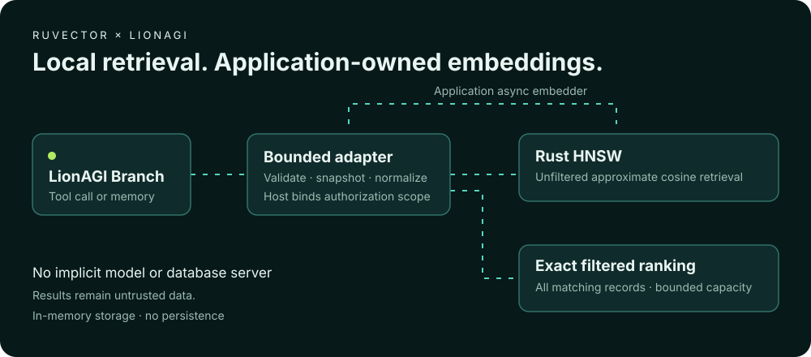

# RuVector memory and retrieval

RuVector adds local native Rust HNSW retrieval to LionAGI Nodes, branch memory and read-only tools. Embeddings come from your application. There is no implicit model download, provider credential or database server.



## Install the optional backend

This integration is proposed in the source tree and is not yet in a published LionAGI release. From this checkout:

```bash
uv sync --extra ruvector
uv run python examples/ruvector_memory.py
```

Once released, applications can select `lionagi[ruvector]`. Import the backend explicitly:

```python
from lionagi.integrations.ruvector import RuVectorMemoryStore, RuVectorStore
```

The default LionAGI import does not load RuVector. Selecting the extra installs `ruvector>=0.1.2,<0.2` and `numpy>=1.24,<3`; supported platforms depend on available native SDK wheels.

## Branch memory

```python
import asyncio
from lionagi import Branch, MemoryItem, MemoryQuery
from lionagi.integrations.ruvector import RuVectorMemoryStore, RuVectorStore

async def embed(text: str) -> list[float]:
    # Toy fixture only. Replace with your application's embedding service.
    return [1.0, 0.0, 0.0]

async def main():
    memory = RuVectorMemoryStore(RuVectorStore(3, capacity=100), embed)
    branch = Branch(memory=memory)
    item = MemoryItem(content="Deployment notes", tags=["ops"], metadata={"project": "demo"})
    key = await branch.memory.store(item)
    restored = await branch.memory.retrieve(key)
    assert restored is not None and restored.content == item.content
    hits = await branch.memory.search(
        MemoryQuery(text="deployment", tags=["ops"], filters={"project": "demo"}, limit=1)
    )
    assert hits[0].id == key

asyncio.run(main())
```

For a retrieval tool, populate a separate Node store and pass `tools=[store.as_tool(embed)]` to `Branch`. The tool is named `ruvector_search` and accepts only `query` and `k`. The runnable example calls it through real `Branch.act` without an LLM. LionAGI may write its normal local logs.

## Fidelity and semantics

The implementation uses the current structural `MemoryStore` protocol. It does not claim to implement the proposed manifest API in [ADR 0093](../adr/ADR-0093-external-memory-adapter-fidelity-contract.md).

| Concern | Contract |
| --- | --- |
| Content | Text only; arbitrary Python content is rejected |
| Identity | UUID and creation time preserved; duplicate IDs rejected |
| Metadata and tags | Detached finite JSON and bounded tag lists, preserved on read/search |
| Visibility | Successful insertion is immediately available in this process |
| Text query | Semantic cosine similarity, unlike the default substring backend |
| Tags | Any supplied tag matches |
| Filters | All supplied metadata key/value equalities must match |
| Unfiltered retrieval | Native approximate HNSW, cosine distance ascending |
| Filtered retrieval | Exact cosine ranking over all eligible records; linear scan |
| No text query | Insertion-order scan without embedding |
| Missing ID | `None`; underlying failures propagate |
| Limits | Positive limit bounded by configured maximum; no silent truncation of invalid inputs |
| Persistence | None; process exit discards data |

Use a dedicated store for memory envelopes. Do not mix ordinary Nodes into it. Unknown filter keys match no records unless the stored metadata value compares equal to the requested value; equality follows the default backend's Python equality semantics, including its missing-key/None behavior.

## Security and resource boundaries

Use a separate store per authorization scope. Metadata filtering is not authentication. The host binds the embedding callback and store before exposing a tool. Tool results carry `untrusted_data=True`; this marker does not prevent prompt injection or replace tool permissions.

Inputs are bounded by dimensions, finite coordinate values, UTF-8 payload size, finite JSON nesting, record count, batch size, aggregate payload and output size. The nominal vector budget is not a process RSS guarantee: graph structures, Python objects and deletion rebuilds allocate additional memory. Use process limits when a hard cap is required.

No pickle or dynamic class reconstruction is used. Metadata containing `lion_class` remains inert JSON. Native insertion failures poison the store to prevent subsequent use of inconsistent state. A failed deletion rebuild leaves the existing index usable. Deletion costs O(n) and temporarily duplicates the index.

Async methods offload synchronous operations to worker threads and serialize access per store. Cancellation cannot roll back a native operation that has already started. Retrieve the known UUID before retrying. Embedding code owns authorization, timeouts, retries, network access and cost.

## Validation and benchmarks

```bash
uv run pytest -n0 tests/integrations
uv run python examples/ruvector_memory.py
uv run python benchmarks/ruvector/retrieval.py --ef 100 --output /tmp/ruvector-benchmark.json
```

The native contract suite covers Branch tools, memory fidelity, filtering, cancellation, concurrency, malformed inputs, resource budgets and injected native failures. A separate subprocess test proves core imports work without the extra. See [benchmark evidence](ruvector-benchmarks.md) for reproducible observations and limitations. Synthetic recall is not application relevance, and scanner success does not establish complete security.

## Ownership and release

This code lives in LionAGI and depends directly on the RuVector SDK. It does not depend on the separately proposed `ruvector-lionagi` distribution, avoiding a circular package dependency. Adoption makes LionAGI the owner of this upstream implementation; any separate distribution should become a compatibility facade or be retired rather than evolving a second implementation.

Existing LionAGI CI and publishing remain authoritative. This contribution adds no publishing credentials, workflow dispatch, version bump or release authority. Upstream maintainers decide whether to merge and release it.

## Optional durable memory

See [RVF persistence and relevance feedback](ruvector-durable-learning.md) for the
optional durable store, native SDK prerequisite and bounded preference adaptation.
The default `RuVectorStore` remains in memory.
